# POSgrade — Aplikasi Point of Sale (Native HTML + Node.js + PocketBase)

Aplikasi kasir (POS) ringan dengan **tiga teknologi inti** dan **nol framework frontend**:

| Lapisan | Teknologi | Catatan |
| --- | --- | --- |
| Database, Auth, API | **PocketBase** (single binary, SQLite) | REST API + dashboard admin bawaan |
| Web server | **Node.js** (modul `http` bawaan) | 0 dependency npm, sekaligus reverse proxy |
| Antarmuka | **HTML + CSS + Vanilla JS (ES Modules)** | tanpa bundler, tanpa build step |

---

## 1. Tampilan aplikasi

Semua gambar di bawah diambil otomatis dari aplikasi yang benar-benar berjalan
(Chrome headless + DevTools Protocol), bukan mockup.

| | |
| --- | --- |
| **Login** | **Dashboard** |
| 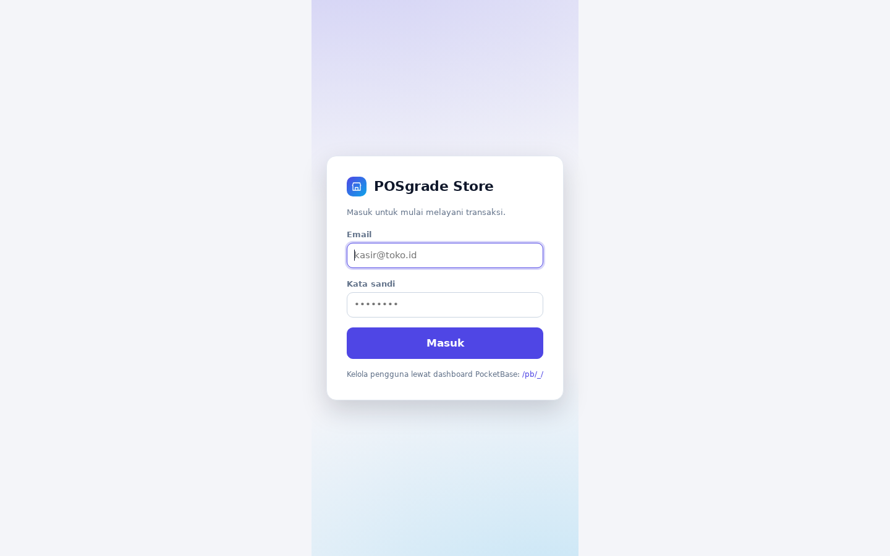 | 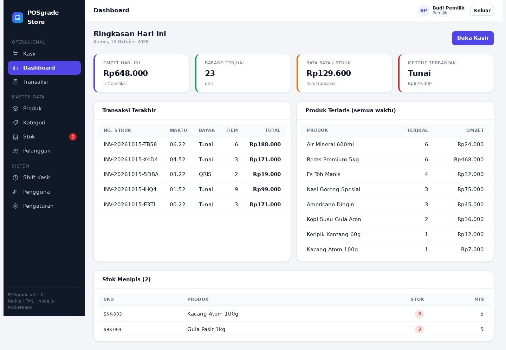 |
| **Kasir — keranjang** | **Kasir — pembayaran** |
| 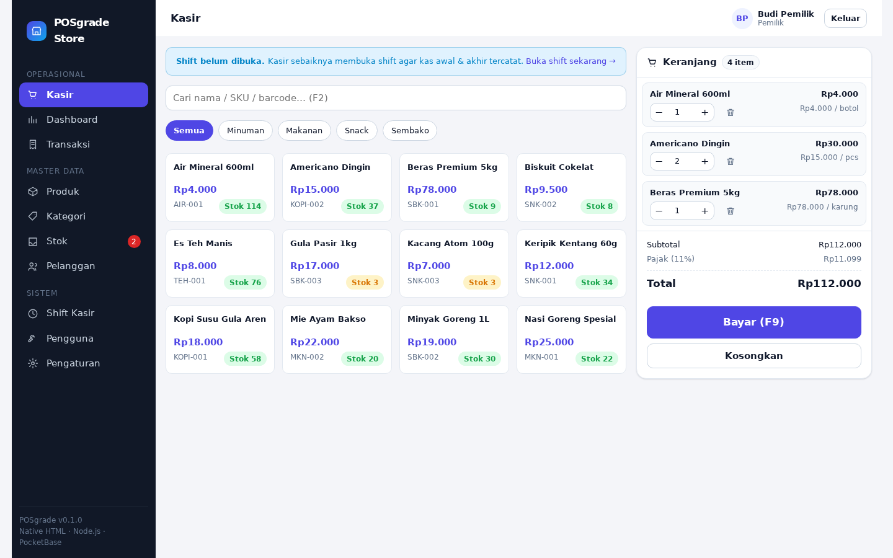 | 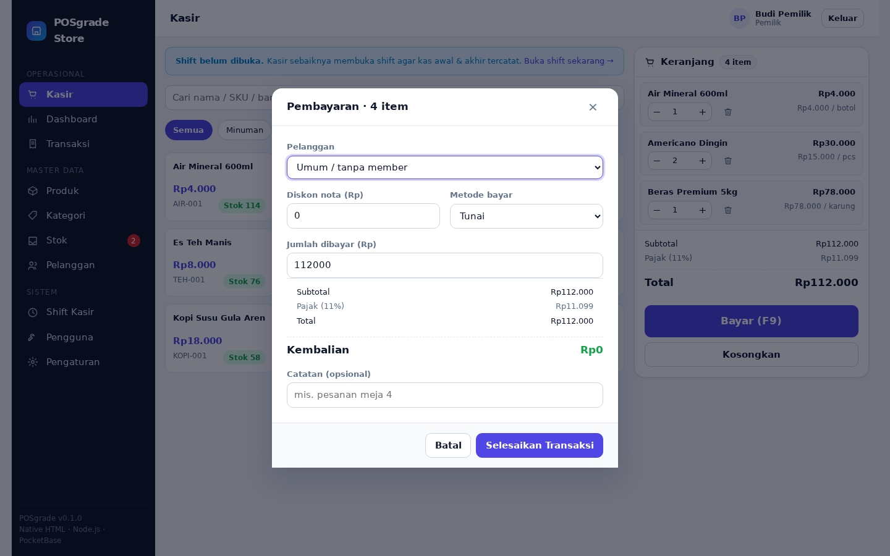 |
| **Struk setelah transaksi** | **Produk** |
| 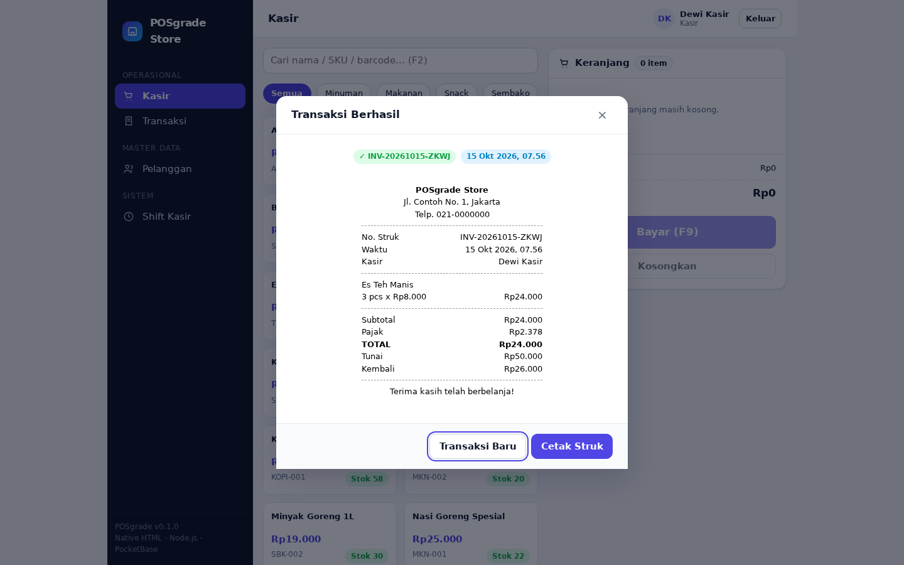 | 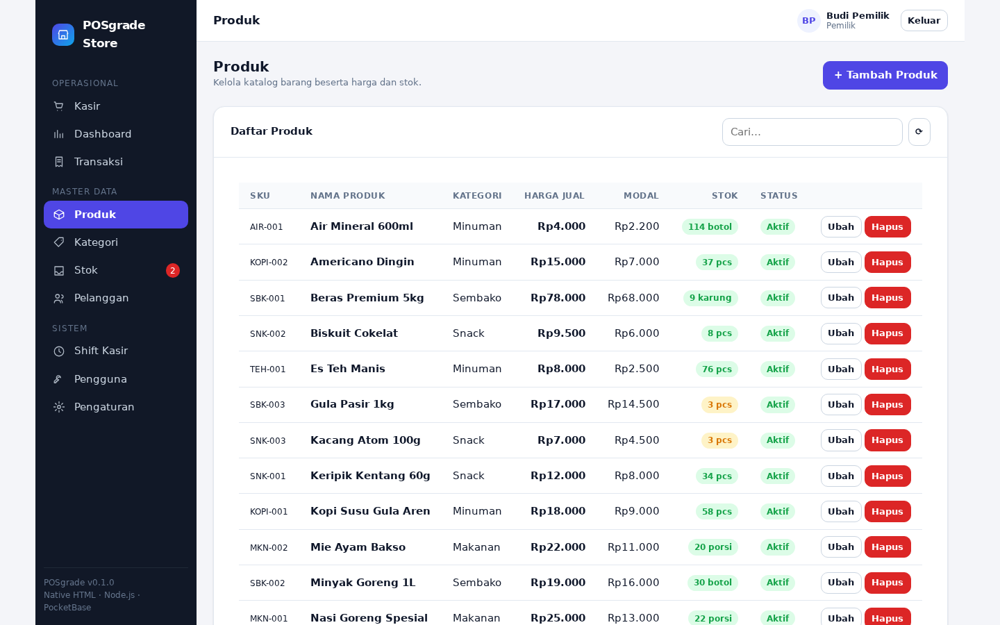 |
| **Riwayat Transaksi** | **Stok & audit mutasi** |
| 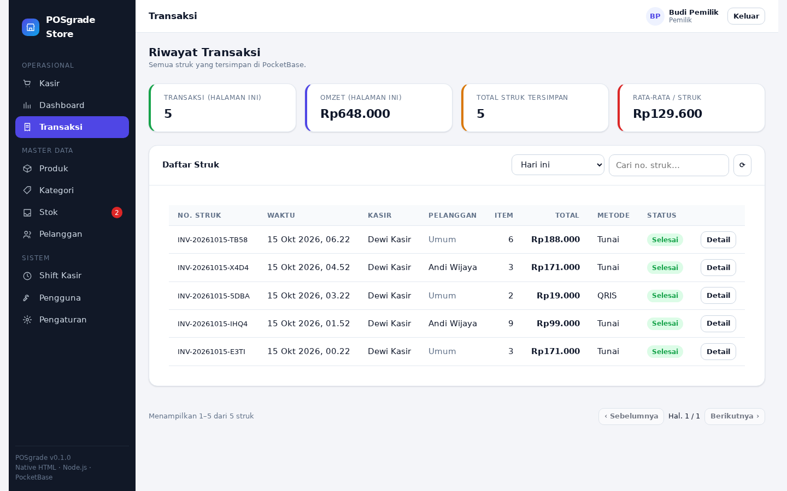 | 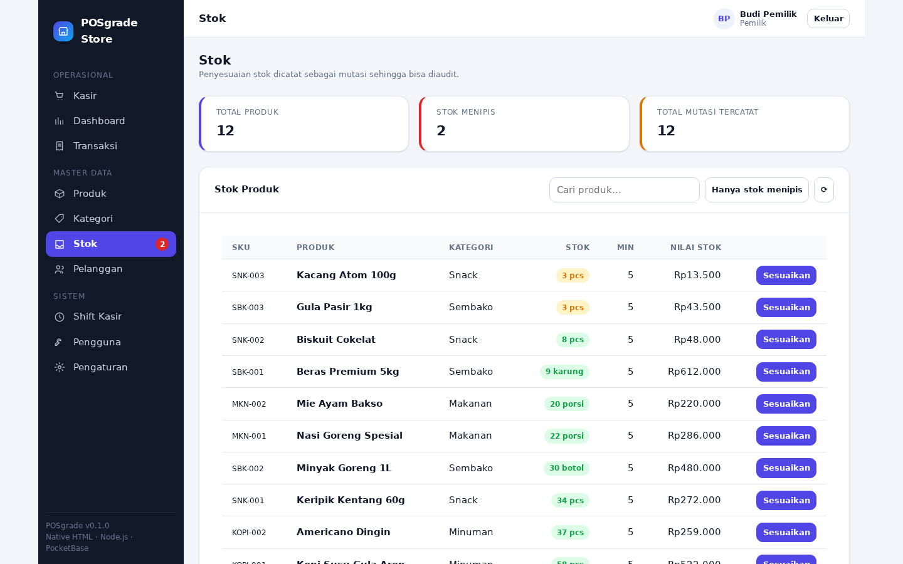 |
| **Shift kasir** | **Pengguna & peran** |
| 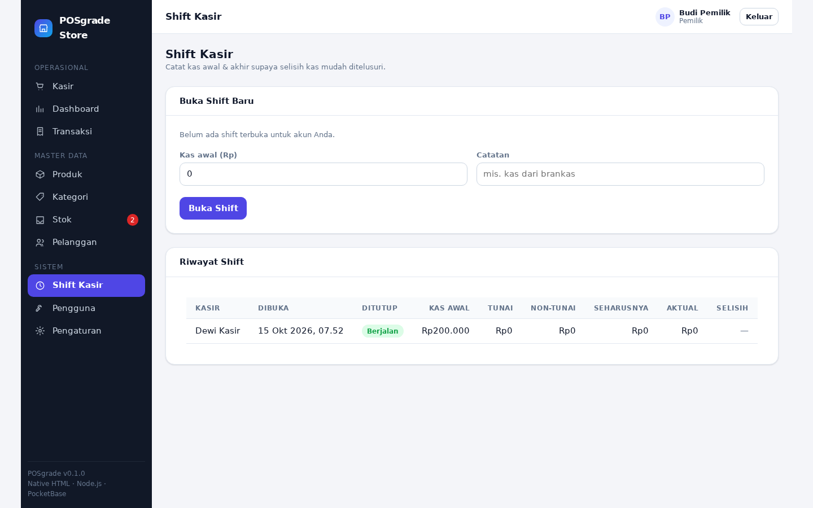 | 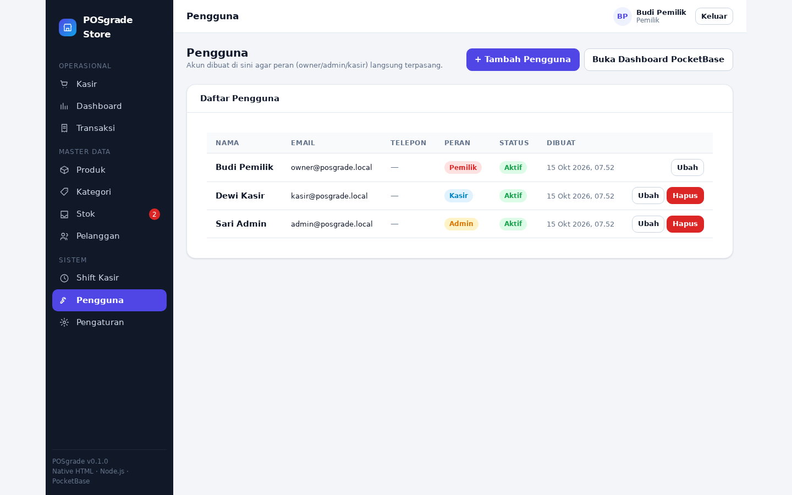 |
| **Tampilan tablet kasir (820px)** | **Kategori & pelanggan** |
| 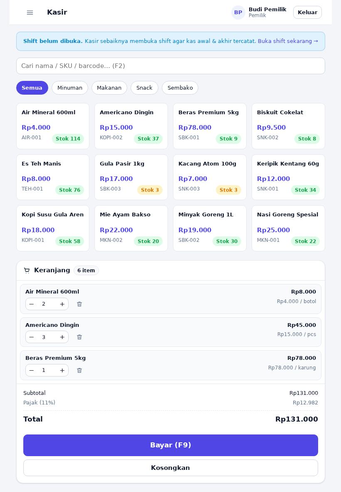 | 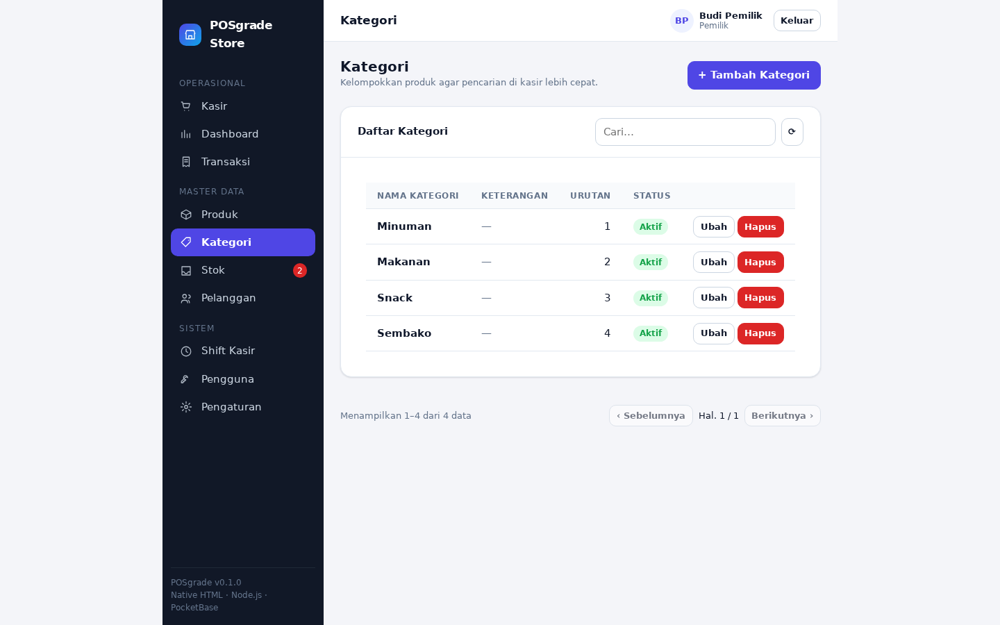 |

Seluruh 17 gambar ada di [`docs/screenshots/`](docs/screenshots/).

---

## 2. Fitur yang sudah jalan

- 🔐 **Login & peran** — `owner`, `admin`, `cashier`, ditegakkan lewat API Rules PocketBase (bukan sekadar menyembunyikan menu).
- 🛒 **Kasir (POS)** — pencarian produk (nama/SKU/barcode), filter kategori, keranjang persisten, diskon nota, pajak, pembulatan, multi metode bayar, pintasan `F2` / `F9`.
- 🧾 **Struk** — nomor struk digenerate **di server**, cetak & cetak ulang, cocok untuk printer 58/80 mm.
- 📦 **Master data** — produk, kategori, pelanggan (CRUD + pencarian + paginasi).
- 📥 **Stok** — pengurangan otomatis saat penjualan, pengembalian saat void/refund, **audit trail** (`stock_moves`), penyesuaian manual.
- 🕒 **Shift kasir** — kas awal, kas seharusnya, kas aktual, dan selisih.
- 📊 **Dashboard** — omzet harian, jumlah transaksi, produk terlaris, stok menipis.
- 🧑‍💼 **Pengguna** — kelola akun & peran (khusus owner).
- ⚙️ **Pengaturan toko** — identitas, pajak, pembulatan, footer struk.

---

## 3. Mulai cepat (1 perintah)

```bash
npm run dev
```

Perintah tersebut otomatis:

1. membuat `.env` dari `.env.example` (bila belum ada),
2. mengunduh binary PocketBase ke `.tools/`,
3. membuat superuser `admin@posgrade.local`,
4. menjalankan PocketBase di `127.0.0.1:8090` + aplikasi di `http://127.0.0.1:3000`.

Buka **http://127.0.0.1:3000**, lalu login memakai data contoh:

| Peran | Email | Sandi |
| --- | --- | --- |
| Pemilik | `owner@posgrade.local` | `posgrade123` |
| Admin | `admin@posgrade.local` | `posgrade123` |
| Kasir | `kasir@posgrade.local` | `posgrade123` |

> Akun demo dibuat oleh `npm run pb:seed`. Untuk database kosong, lewati seed dan
> buat akun pertama dari Dashboard PocketBase (`http://127.0.0.1:8090/_/`) dengan
> mengisi field `role = owner`.

### Perintah lain

```bash
npm start                  # jalankan hanya web server Node
npm run pb                 # jalankan hanya PocketBase
npm run pb:migrate         # terapkan migration secara manual
npm run pb:seed            # data contoh (user, kategori, produk, pelanggan)
npm run pb:seed:sales      # data contoh + 6 transaksi hari ini (agar dashboard berisi)
npm run pb:adopt-users     # perbaiki user PocketBase lama agar bisa dipakai (lihat §4)
npm run pb:superuser -- admin@toko.id rahasia123
npm run check              # cek sintaks server
```

---

## 4. Sudah punya PocketBase / akun lama?

**PocketBase tidak punya akun "cloud".** Setiap akun — baik *superuser* (untuk
dashboard `/_/`) maupun *user* (untuk aplikasi) — tersimpan di dalam file
`pb_data/data.db` milik instance itu sendiri. Jadi jawabannya bergantung pada
akun lamanya ada di mana:

| Situasi | Bisa dipakai langsung? |
| --- | --- |
| Akun lama ada di **pb_data yang sama** yang dipakai project ini | ✅ Ya |
| Akun lama ada di **instance PocketBase lain** (server lain, project lain) | ❌ Tidak otomatis — perlu salah satu dari 3 opsi di bawah |
| Akun aplikasi lama (koleksi `users`) yang belum punya field `role` | ❌ Belum — jalankan `npm run pb:adopt-users -- --apply` |

Ada **dua jenis akun** yang jangan dicampur:

| Jenis | Koleksi | Dipakai untuk |
| --- | --- | --- |
| **Superuser** | `_superusers` | Login dashboard PocketBase `/_/`, akses penuh |
| **User** | `users` | Login aplikasi POSgrade; punya `role` (owner/admin/cashier) |

### Opsi A — Pakai instance PocketBase lama Anda sebagai backend

Project ini bisa diarahkan ke PocketBase mana pun. Cukup ubah `.env`:

```bash
PB_URL=https://pb.domain-anda.com      # atau http://IP-lama:8090
PB_ADMIN_EMAIL=superuser-lama@anda.com
PB_ADMIN_PASSWORD=sandi-lama
```

Lalu terapkan skema POSgrade ke instance tersebut (tanpa menyentuh data lama):

```bash
.tools/pocketbase migrate up \
  --dir /path/ke/pb_data-lama \
  --migrationsDir ./pb/pb_migrations \
  --hooksDir ./pb/pb_hooks
```

⚠️ Perhatikan: migration `1750000004_extend_users` akan **gagal** bila koleksi
`users` lama Anda sudah punya field bernama `role`, `active`, `full_name`, atau
`phone` (error *duplicate field name*), dan migration `1750000006_users_rules`
akan **menimpa API Rules** koleksi `users` lama Anda. Bila salah satu kondisi itu
terjadi, lebih aman pakai Opsi C.

### Opsi B — Bawa pb_data lama ke project ini

```bash
cp -r /path/ke/pb_data-lama/. ./pb/pb_data/
npm run pb:migrate
npm run pb:adopt-users          # pratinjau dulu, lalu tambahkan --apply
```

Hash kata sandi (bcrypt) ikut berpindah, jadi **sandi lama tetap berlaku**.
Risiko skema sama dengan Opsi A.

### Opsi C — Instance baru (paling bersih, direkomendasikan)

```bash
npm run pb:superuser -- email-anda@domain.com sandi-kuat   # superuser baru
```

Lalu buat user POS pertama dengan `role = owner` dari salah satu cara:

- Dashboard `http://127.0.0.1:8090/_/` → Collections → `users` → **New record**
  (isi `email`, `password`, `role = owner`, `active = true`), atau
- setelah login sebagai owner, buka halaman **Pengguna** (`#/users`) di aplikasi.

### Mengadopsi user lama: `scripts/adopt-users.mjs`

User yang dibuat di instance lain belum punya `role` dan `active`, sehingga:

- `active` bernilai `false` → halaman login menolak: *"Akun Anda sedang dinonaktifkan"*.
- `role` kosong → login berhasil tapi hak akses kosong (hampir semua tulis ditolak API Rules).

Skrip ini **hanya mengisi field yang kosong** — nilai yang sudah ada tidak diubah:

```bash
npm run pb:adopt-users                        # pratinjau (dry-run), tidak menulis apa pun
npm run pb:adopt-users -- --apply             # terapkan, role default = cashier
npm run pb:adopt-users -- --apply --role=owner
npm run pb:adopt-users -- --apply --only=email@toko.id
```

### Yang tidak ikut berpindah

- **Token sesi lama** — token ditandatangani dengan `authTokenSecret` milik
  instance, jadi pengguna harus login ulang.
- **Sandi bila Anda membuat ulang akun** (bukan memindahkan `pb_data`) — buat
  user baru dengan email sama tidak mewarisi sandi lama; harus diset ulang.

---

## 5. Struktur proyek

```
.
├── server/                     # Web server Node.js (zero dependency)
│   ├── index.js                #   routing: statis + /config.js + /healthz + proxy
│   ├── config.js               #   pembaca .env tanpa library
│   └── lib/{static,proxy,mime}.js
├── public/                     # Frontend native (tanpa build step)
│   ├── index.html
│   ├── css/{base,app}.css      #   design token + komponen
│   └── js/
│       ├── main.js             #   bootstrap + definisi route
│       ├── api.js              #   instance PocketBase + pintasan koleksi
│       ├── services.js         #   logika domain (transaksi, shift, stok, laporan)
│       ├── lib/                #   pb, router, dom, cart, modal, toast, format, receipt, store
│       ├── components/         #   layout, table, form
│       └── views/              #   login, dashboard, pos, crud, sales, stock, shifts, users, settings
├── pb/
│   ├── pb_migrations/          # 7 migration: schema + pengaturan default + rule users
│   └── pb_hooks/main.pb.js     # logika server: nomor struk, stok otomatis, void
├── scripts/                    # setup-pocketbase.sh, pocketbase.sh, dev.sh,
│                               # seed.mjs, adopt-users.mjs
└── docs/                       # RENCANA, ARSITEKTUR, DATA-MODEL, ROADMAP
```

---

## 6. Arsitektur singkat

```
Browser (HTML/JS native)
   │  fetch("/pb/api/collections/...")
   ▼
Node.js :3000  ── /config.js · /healthz · file statis
   │  reverse proxy (same-origin, bebas CORS)
   ▼
PocketBase :8090 ── REST API · Auth · SQLite · Dashboard /_/
   └── pb_hooks/main.pb.js (nomor struk, stok otomatis, void)
```

Browser tidak pernah tahu URL PocketBase sebenarnya — semuanya lewat `/pb/*`
yang diteruskan server Node. Penjelasan lengkap: [`docs/01-ARSITEKTUR.md`](docs/01-ARSITEKTUR.md).

---

## 7. Keamanan & hak akses

Aturan akses ditegakkan di **server PocketBase** (API Rules), bukan hanya di UI:

| Koleksi | List | Create | Update | Delete |
| --- | --- | --- | --- | --- |
| `products`, `categories` | login | owner/admin | owner/admin | owner |
| `customers` | login | login | login | owner/admin |
| `sales`, `sale_items` | login | login | owner/admin | owner |
| `stock_moves` | login | login | owner/admin | owner |
| `shifts` | login | login | pemilik shift / owner / admin | owner |
| `settings` | publik | owner/admin | owner/admin | owner |
| `users` | owner/admin | **owner saja** | diri sendiri / owner | owner |

Kredensial superuser hanya dipakai skrip CLI (`scripts/seed.mjs`) dan
**tidak pernah** dikirim ke browser.

---

## 8. Dokumentasi

| Dokumen | Isi |
| --- | --- |
| [`docs/00-RENCANA.md`](docs/00-RENCANA.md) | Rencana & keputusan awal proyek |
| [`docs/01-ARSITEKTUR.md`](docs/01-ARSITEKTUR.md) | Arsitektur, alur data, alasan pemilihan teknologi |
| [`docs/02-DATA-MODEL.md`](docs/02-DATA-MODEL.md) | 9 koleksi, relasi, dan aturan akses |
| [`docs/03-ROADMAP.md`](docs/03-ROADMAP.md) | Rencana pengembangan bertahap + TODO teknis |

---

## 9. Menuju produksi

1. Buat superuser sungguhan lalu hapus akun demo (`npm run pb:superuser -- ...`).
2. Set `DEV=0`, bind ke `0.0.0.0`, dan letakkan di belakang reverse proxy HTTPS (Caddy/Nginx).
3. Aktifkan backup berkala: Dashboard → Settings → Backups, atau `./pocketbase backup`.
4. Untuk volume tinggi, pindahkan pembuatan transaksi ke satu hook
   `POST /api/pos/checkout` agar benar-benar atomik (lihat TODO di ROADMAP).

---

## 10. Alternatif: Docker

```bash
docker compose up -d --build
docker compose exec pocketbase /pb/pocketbase superuser upsert admin@posgrade.local posgrade123
docker compose exec web node /app/scripts/seed.mjs   # opsional
# buka http://localhost:3000
```
